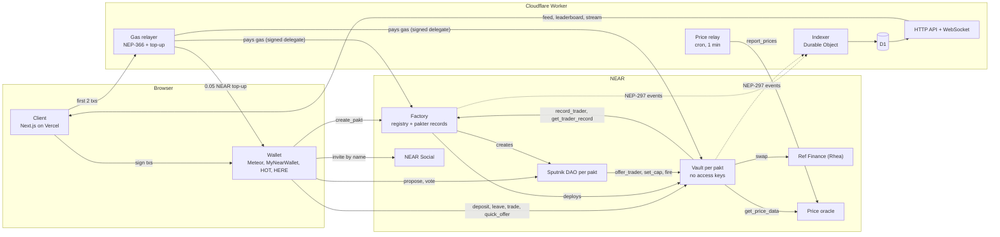
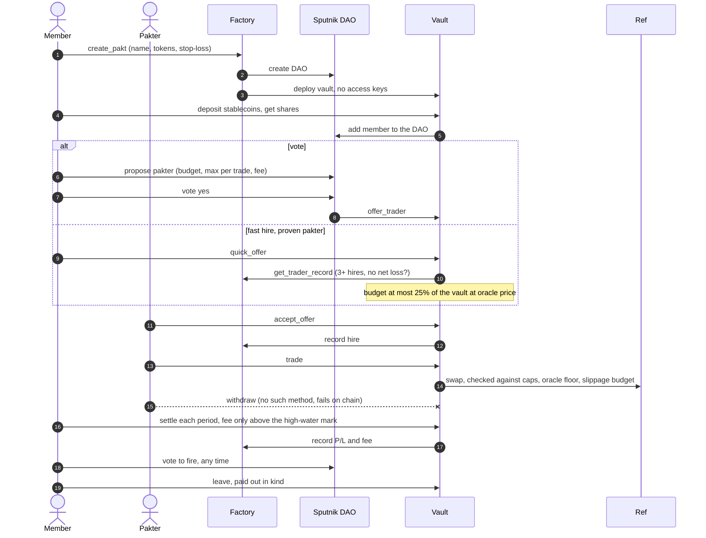

# Pakt

A group trading vault on NEAR: friends pool tokens in a vault, vote one person in as trader, and the trader can swap the pool but can never withdraw it.

**Problem.** Friend groups, Discord/Telegram groups and investment clubs often pool money with the one person who trades well. Today that means "send money and hope": the trader holds everything and the others have no control if the trader loses it, steals it or disappears. Pakt keeps the money in a contract that only lets the trader swap between allowed tokens within voted limits, and only lets members take money out.

**Live app (NEAR testnet):** https://paktdotfam.vercel.app

**Demo video:** https://x.com/paktdotfam/status/2121330739992260679

**Built at NEAR HACKATHON** (Nov 1–14, 2026). Every commit in this repo is from the hackathon window; the first is from 2026-11-12.

**Built on the NEAR ecosystem**
- **Sputnik DAO**: every pakt gets its own DAO. Members vote the pakter in, change caps, and fire them.
- **Ref Finance (Rhea)**: every trade is a real Ref swap with an oracle price floor.
- **NearDeFi price oracle**: values the vault for shares, fees, caps and the swap floor.
- **Gasless first 2 transactions**: a NEP-366 meta-transaction relayer pays the gas when the wallet can sign delegate actions. Wallets that can't yet get a one-time 0.05 NEAR gas top-up instead, so it works in every wallet today.
- **On-chain pakter reputation**: the factory keeps every pakter's hires, fires, P/L and fees across all pakts, so a bad pakter can't start fresh in a new pakt. A proven record unlocks **fast hire**: one member can offer the job without a vote, for a capped budget.
- **NEAR Social**: invite friends by account name (`alice.near`); they get a NEAR Social notification with the pakt link.
- **Named accounts and Wallet Selector**: each pakt is `<name>.<factory>`; sign in with Meteor, MyNearWallet, HOT or HERE.

## Try it in 5 minutes

1. Install the [Meteor wallet](https://wallet.meteorwallet.app) extension and create a **testnet** account. Get a little testnet NEAR from the [NEAR faucet](https://near-faucet.io/) for gas.
2. Open the app and click **Connect**.
3. Click your **balance** (top right) **→ Request test tokens**. The Pakt faucet sends 1,000 tUSDC, 0.01 tBTC and 50 tNEAR (once a day per account).
4. **Join a pakt:** pick one under Explore → Pakts, click **Deposit**, send $5 or more of tUSDC. You get shares and a seat in its DAO.
5. **Vote:** on the pakt page, start a vote (hire a trader, set budget, fire) and vote yes/no under Open votes. On pakts created with the current factory, if the pakter you pick has 3+ hires and no net loss on record, the form offers **Fast hire, no vote** instead (budget up to 25% of the vault). `make e2e` runs this path end to end (`proven_pakter_fast_hired_without_vote`).
6. **Hire someone:** in the sidebar's **Pakters** tab, click **Hire** next to a trader. This starts the hire vote in a pakt you belong to.
7. **Trade:** when a pakt offers you the trader job, an offer card shows on its page. Accept it, wait out the trade delay, then buy and sell inside the caps.
8. **Settle and leave:** anyone can settle when the period ends. **Leave** pays out your share of every token the pakt holds.

The **(i)** button in the top bar explains the contracts behind a pakt, and **Site tour** walks through every screen.

## The app

| Screen | What it shows |
|---|---|
| Explore | All pakts (value, trader, fee, members) with filters; your positions (open and closed); tokens with oracle prices and which pakts hold them |
| Sidebar | Live feed of every on-chain event (deposits, trades, votes, hires, fires, settles); trader leaderboard (7D/30D/all) with Hire; pakt and token lists; your positions. The open tab and collapse state survive reloads |
| Pakt page | Share-price chart with high-water mark; members, trades, votes and settlements; your share with deposit/leave; trader card with set budget/fire; settlement split; open votes; trade panel for the hired trader; one-click fixes when a vault needs recovery (stuck lock, funds at the dex, pending member sync) |
| Profile | Wallet cash at oracle prices, holdings with value and P/L (average cost), trader record, activity |
| Token page | Price chart, which pakts hold it, about the token |

## How it works

1. **Create.** Anyone calls `create_pakt` on the factory (name, token allowlist, stop-loss, open or invite-only, minimum deposit). The factory creates a Sputnik DAO `<name>.<sputnik>` and the vault `<name>.<factory>`, and registers the vault on every allowed token and on Ref.
2. **Register.** Before the first deposit, each member calls `storage_deposit` on the vault (0.01 NEAR, refunded by `storage_unregister` after leaving). It pays for their own storage and DAO sync, so churn can't drain the vault. They also register on the pakt's tokens so payouts arrive (else parked for `claim`).
3. **Deposit.** A member calls `ft_transfer_call` on the base token (e.g. USDC) with the vault as receiver. The vault's `ft_on_transfer` prices the vault through the oracle, mints shares at the current share price, and adds the depositor to the DAO `members` role. Invite-only pakts need an ed25519 invite signature in `msg`.
4. **Vote a trader.** Members put a Sputnik function-call proposal to the vault's `offer_trader` (account, budget, max per trade, fee 10-30%, stop-loss). A majority vote passes it.
   **Or fast-hire a proven one.** Any member calls `quick_offer` with the same terms. The vault reads the pakter's record from the factory (`get_trader_record`) and the vault value from the oracle in one joined call, and opens the offer only if the pakter has 3+ hires, P/L at or above zero, and the budget is at most 25% of the vault. It never replaces an open offer; the DAO can still replace it with `offer_trader` or `fire` the pakter.
5. **Accept.** The chosen account calls `accept_offer` (or `decline_offer`) within 3 days. Trading opens after the trade delay.
6. **Trade.** The trader calls `trade` (pool id, token in, token out, amount, min out). The vault swaps on Ref (Rhea): deposit to Ref, `swap`, withdraw back, checking caps, the oracle floor and the slippage budget.
7. **Settle.** Anyone calls `settle` once per settle period. Profit above the high-water mark pays the trader fee and the 1% platform fee as newly minted shares.
8. **Fire, leave, claim.** The DAO votes `fire` (if the vault is busy the trader is paused and anyone runs `finish_fire`). A member calls `leave(shares)` and gets a pro-rata slice of every token, in kind. A failed payout is retried with `claim(token)`.

## How NEAR is used

| NEAR feature | Use in Pakt |
|---|---|
| Sputnik DAO | One DAO per pakt. Members vote on `offer_trader`, `set_cap`, `resume`, `fire`. The vault keeps the `members` role equal to depositors through its own `vault` role (`add_member_to_role` / `remove_member_from_role`); retries via `sync_member`. See `contracts/vault/src/dao.rs`, `contracts/factory/src/policy.rs`. |
| Named sub-accounts | Each vault is `<name>.<factory>`, e.g. `alphafund.pakt.pakt-0mxhjh.testnet`. See `contracts/factory/src/name.rs`. |
| NEP-141 tokens | Deposits through `ft_transfer_call`, payouts through `ft_transfer`. Only allowlisted tokens. |
| Account with no access keys | The factory creates, funds, deploys and inits the vault in one batch and adds no key, so the vault code cannot be changed. |
| Ref (Rhea) exchange | All trades are Ref `swap` actions (`ref-finance-101.testnet`, `v2.ref-finance.near`). See `contracts/vault/src/trade.rs`. |
| Price oracle | NearDeFi price-oracle `get_price_data` values the vault for shares, fees, caps and the swap floor. See `contracts/vault/src/oracle.rs`. |
| Meta transactions (NEP-366) | A new account's first 2 transactions are sponsored. If the wallet signs a delegate action, the backend relayer (`POST /relay`) checks the signature, wraps it and sends it from the faucet account. Only Pakt contracts and methods are allowed, max 2 per account, counted atomically in D1. Any attached deposit still comes from the user. Meteor, MyNearWallet, HOT and HERE don't sign delegate actions yet (wallet-selector 10.1.4), so for them the backend sends a one-time 0.05 NEAR top-up to accounts holding less than that (`POST /relay/topup`, one per account, 3 per IP per day). See `backend/src/sponsor.ts`. |
| Factory as reputation registry | Vaults report hire, fire and every fee mark to the factory (`record_trader`, callable only by vaults in the factory's own registry). `get_trader_record(account)` returns hires, fires, P/L and fees across all pakts; the pakt page shows it next to the pakter and on offers. The vault pays the record's storage. Vaults also read it on chain to gate fast hire (`quick_offer`, `contracts/vault/src/trader.rs`). |
| NEAR Social | "Invite" on a pakt posts a `social.near` (`v1.social08.testnet`) post that @mentions each invitee, so it shows in their notifications with the pakt link. See `client/src/lib/social.ts`. |
| Wallet Selector | Meteor, MyNearWallet, HOT and HERE through `@near-wallet-selector`. |
| NEP-297 events | Factory and vault log `EVENT_JSON` (`standard: "pakt"`). The backend indexes them for the feed and leaderboard. |

## Threat model

How someone could try to take the money, and what stops them. Details in the table below.

| Attack | Who | What stops it |
|---|---|---|
| **Rug: the pakter withdraws the vault** | Pakter | There is no withdraw method for a pakter. `trade` only swaps between whitelisted tokens through Ref, and the output comes back to the vault. Try it on a pakt page as the pakter: the call fails on chain. |
| **Thin-pool dump: swap at a terrible price into a pool the pakter controls** | Pakter | Every swap has a floor of oracle price minus 2%. Realized slippage is capped at 3% of vault value per 24h, and the stop-loss pauses trading. |
| **Oracle push: fake a price to drain on deposit, leave or fee** | Price reporter | Not fully stopped: whoever reports prices is trusted, since a pushed price moves the swap floor, deposits and fees. On testnet that's one relay key, a known limit. Mainnet needs a public oracle with no team key. |
| **Vote takeover: flood the DAO with fake members** | Outsider | $5 minimum deposit at oracle price plus a per-pakt minimum. Votes need a majority of members, and a new pakter waits out a trade delay, so members can leave first. |
| **Griefing: lock the vault so nobody can leave** | Anyone | Deposits and leaves run as counted flows, not behind the trade lock. Any lock older than 10 min can be cleared by anyone with `unlock`. Fire always pauses first and can be finished by anyone. |
| **Farmed record: build fake hires, then fast-hire into a real pakt** | Pakter | Fast hire still needs a real member to send the offer and the pakter to accept. The budget is capped at 25% of the vault, the trade delay lets members leave first, the oracle floor, slippage budget and stop-loss still apply, and the DAO can fire at any time. Farming hires costs a new pakt (12.65 NEAR on testnet) per fake hire. |
| **Bad pakter, mid-trade** | Pakter | A fire vote pauses the pakter immediately, even with a trade in flight. The rest of the fire (fee to date, removal) is finished by anyone once the trade lock clears. |

## Security guarantees

| Guarantee | How it is enforced |
|---|---|
| The trader can never withdraw | No vault method sends tokens to the trader. `trade` only moves tokens to and from the Ref account; `leave` pays only the caller's own shares. The trader's fee is paid as shares, the same as any holder. |
| Token allowlist | Factory `config.tokens` / `base_tokens` limit what a pakt may hold; vault `token_index` rejects any other token. Non-base deposits are refunded. |
| Every swap has an oracle price floor (2%) | `min_amount_out` is raised to oracle price minus `MAX_SLIPPAGE_BPS = 200` (`trade.rs`). |
| 3% slippage budget per 24h | Each swap books its worst case (the full 2% oracle floor) in `slip_used`, a leaky bucket that holds half of `MAX_PERIOD_SLIP_BPS = 300` of vault value and refills that half per day (`slip_since_ms`), so no 24h span can lose more than 3%. Independent of the settle period. |
| Trade delay after hire or cap raise | `trade_after_ms` is set on `accept_offer` and pushed forward by a `set_cap` that adds spend room, so members can leave first (minimum 60 s, `trade_delay_ms`). |
| Per-trade cap and total budget | `within_caps` checks `max_per_trade` and `budget` in USD. |
| Fast hire only for a proven record, with a smaller budget | `on_quick_offer` requires a factory record with `QUICK_MIN_HIRES = 3` hires and P/L >= 0, a budget at most `QUICK_BUDGET_BPS = 2500` (25%) of vault value at oracle price, a caller who is a member, and no open offer. Same fee, cap and stop-loss checks as a voted offer. |
| Stop-loss pause | `check_stop_loss` pauses the trader when share price drops `stop_loss_bps` below the mark; only a DAO `resume` restarts trading. |
| Fees only above the high-water mark | `crystallize` charges fees only on share-price gain above `hwm`, and runs before every deposit, leave and fire, so new money never pays for old profit and leaving never dodges fees. |
| $5 minimum deposit | `on_deposit` refunds anything worth under $5 at oracle price (`MIN_DEPOSIT_USD_E6`), plus a per-pakt `min_deposit`, so dust accounts can't flood the vote. |
| Internal ledger | Balances live in `balances` / `at_dex`, never read from `ft_balance_of`, so tokens sent directly (donations) can't move the share price. |
| Concurrency and stale-lock unlock | Trade, accept, fire and recover hold an exclusive lock (`op`); deposits, leaves and settles run as counted flows, so deposit spam can't block leaving. A lock or flow older than 10 min is cleared by anyone with `unlock`. Callbacks carry `op_id` / `flow_gen`, so a stale callback is ignored (a stale deposit is refunded). |
| DAO name squatting | The factory puts a random nonce in the DAO metadata and checks it in `on_dao_check`; a squatted `<name>.<sputnik>` aborts and refunds. |
| Backend hardening | Per-IP rate limits (60/min API, 10/min stream, 1/min faucet, 6/min gas relay on `POST /relay` and `POST /relay/topup`), validated account ids and query params, only events emitted by the factory or a direct `<name>.<factory>` vault are indexed (`trusted` in `backend/src/chain.ts`), CORS allowlist. Writes are only the faucet (`POST /faucet`), the gas relayer (`POST /relay`, `POST /relay/topup`) and a token-guarded `POST /admin/start`. |
| Faucet limits | `POST /faucet` sends test tokens from a dedicated pre-funded account (its key is a Worker secret; the owner key never touches the backend). One claim per account per day and 3 per IP per day, tracked in D1 (`faucet_claims`); the account must exist on chain. |

Two independent security reviews were run on the contracts and backend (not a professional third-party audit); their findings were fixed and have regression tests (`contracts/vault/src/audit_tests.rs`, `contracts/vault/src/review_tests.rs`, `contracts/e2e/tests/audit.rs`).

**Known limits**

- Deposit and leave use the oracle price, which lags the market; a member who sees a move before the oracle can enter or exit at the stale price.
- Fees are marked at whatever price the oracle reports at deposit/leave/settle; a short price spike can crystallize a fee that the price then gives back.
- A DAO majority can use function-call proposals to spend the DAO account's own small NEAR balance (not the vault's tokens).
- Testnet Ref pools drift from the oracle price; re-centre them with `scripts/deploy-testnet.sh --reseed` or trades hit the 2% floor.
- A mainnet oracle is still to be chosen: `priceoracle.near` has been stale since March 2026. The plan for it is in [MAINNET.md](MAINNET.md).
- Fast hire counts hires, not their quality: a pakter with flat or tiny-profit hires qualifies. The 25% budget cap and the DAO's fire vote bound the risk.
- Vaults have no keys, so pakts created before fast hire shipped don't have it; the app hides the option for them.

## Quickstart for judges

Prerequisites: Rust with the `wasm32-unknown-unknown` target (`rustup target add wasm32-unknown-unknown`), bun, near-cli-rs (deploy only), jq, python3. `cargo-near` and `wasm-opt` are used when present. All commands run from the repo root. `make help` lists targets.

| Do | See |
|---|---|
| `make build-contracts` | `contracts/res/` lists `pakt_vault.wasm`, `pakt_factory.wasm`, `pakt_mock_ft.wasm`. |
| `cd contracts && cargo test` | Unit tests for vault, factory and mock token: `76 passed` for vault, `22 passed` (plus 1 sandbox) for factory, `4 passed` for the mock, `0 failed`. |
| `make e2e` | Builds wasm, starts a local NEAR sandbox with the real Sputnik DAO, NearDeFi price-oracle and Ref exchange wasm (`contracts/res/external/`), runs `contracts/e2e/tests`. Expect `test result: ok. 19 passed` for `scenarios` and `3 passed` for `audit` and `1 passed` for `gas` (8-token create + full leave fit 300 TGas). |
| `make smoke` | ~1 min. Sandbox + local Worker: one pakt, one deposit. Prints `smoke: <event kinds>` from `/feed`, including `pakt_created` and `deposit`. |
| `make stack-e2e` | Sandbox runs one pakt through every event kind; the local Worker indexes it; checks HTTP routes, WebSocket push and restart catch-up. Ends with `STACK E2E PASS`. |
| `make backend-test` | `tsc --noEmit` clean, then vitest in workerd: `Tests 92 passed`. |
| `make client` | Next.js dev server; open http://localhost:3000. |

`make e2e` proves, on the sandbox:

- happy path: create, deposit, hire, settle with fees;
- leave pays in kind after fees and removes the DAO member;
- a loss then recovery charges no fee; a deposit above the mark pays no old profit;
- access control: only the DAO, the offered trader, or the trader can call their methods;
- factory rejects tokens outside its allowlist; invite-only needs a valid invite signature;
- deposits and leaves overlap without blocking each other; a failed payout is owed, then claimed;
- `fire` pays profit-only fees and waits for prices with the oracle down (trader paused), then fires anyway after an hour;
- trades: happy path, refused below the oracle floor, per-trade and budget caps, stop-loss pause then DAO `resume`;
- a failed Ref withdraw parks funds, then `dex_recover` brings them home;
- a failed member sync is retried with `sync_member`;
- fast hire: a pakter with 3 real hires is offered by one member with no vote and accepts; a pakter with no record, a budget over 25% of the vault, and a non-member caller are all refused;
- audit regressions: low-NEAR vault refuses deposits but never locks; a sybil majority that hires itself waits out the trade delay and loses under 3%; member sync pays the DAO's storage.

## Testnet deployment

`scripts/deploy-testnet.sh` deploys the oracle, three mock tokens at mainnet decimals (tUSDC 6, tBTC 8, tNEAR 24), two Ref pools seeded at the live price, and the factory.

1. `make build-contracts`
2. `OWNER=<your testnet account> bash scripts/deploy-testnet.sh`: dry run. Prints every near-cli-rs command and a NEAR cost estimate; changes nothing.
3. Add `--execute` to run them. The script prints the Worker vars `PAKT_FACTORY`, `PRICE_ORACLE`, `PRICE_MAP`.
4. `bash scripts/deploy-testnet.sh --reseed --execute` re-centres the pools on the oracle price later.

Live demo: https://paktdotfam.vercel.app (client on Vercel, backend on Cloudflare Workers)

Deployed accounts (testnet):

| Contract | Account | Deploy tx | Explorer |
|---|---|---|---|
| Factory (vault code inside) | `pakt.pakt-0mxhjh.testnet` | Deployed [`6MW5FEkb…`](https://testnet.nearblocks.io/txns/6MW5FEkbbU2n7uBkHBcj3XoYcjWWSaExNB4CdpEHkotz), fast hire upgrade [`3bCuYJkA…`](https://testnet.nearblocks.io/txns/3bCuYJkAtS8fcBXbyNUbsYYmX4mRzvSGZaPPCdodA5oG) | [nearblocks](https://testnet.nearblocks.io/address/pakt.pakt-0mxhjh.testnet) |
| Price oracle | `oracle.pakt-0mxhjh.testnet` | Deployed [`CNpZr68D…`](https://testnet.nearblocks.io/txns/CNpZr68Dh8ci4xgFPrKHudFSMQGwJh1d47HnajnHFXJT) | [nearblocks](https://testnet.nearblocks.io/address/oracle.pakt-0mxhjh.testnet) |
| tUSDC token | `tusdc.pakt-0mxhjh.testnet` | Deployed [`GQkx1RY7…`](https://testnet.nearblocks.io/txns/GQkx1RY7KgVNh2CjVi56UQP6zxHGr7eArieNnUmzdE4Q) | [nearblocks](https://testnet.nearblocks.io/address/tusdc.pakt-0mxhjh.testnet) |
| tBTC token | `tbtc.pakt-0mxhjh.testnet` | Deployed [`8qN2GYdX…`](https://testnet.nearblocks.io/txns/8qN2GYdXkJxsjXyJwCKZYfwG3fLdePsWXdNk48WHrBju) | [nearblocks](https://testnet.nearblocks.io/address/tbtc.pakt-0mxhjh.testnet) |
| tNEAR token | `tnear.pakt-0mxhjh.testnet` | Deployed [`ADY192Pu…`](https://testnet.nearblocks.io/txns/ADY192PuLr5axtw9BRTJM5PzHkYnF3SETqvZgFnnwqca) | [nearblocks](https://testnet.nearblocks.io/address/tnear.pakt-0mxhjh.testnet) |
| Test token faucet + gas relayer | `faucet.pakt-0mxhjh.testnet` | Created [`533fDkVx…`](https://testnet.nearblocks.io/txns/533fDkVx7sz79jdKxwS8oBXFv4FSkxzoMRUjGBakt4Ln) | [nearblocks](https://testnet.nearblocks.io/address/faucet.pakt-0mxhjh.testnet) |
| Platform fees | `pakt-fees.testnet` | Created [`BeFd3Ngj…`](https://testnet.nearblocks.io/txns/BeFd3Ngjb3djY6DMS7cir385BdPhrZb7hbspqwV8hpWR) | [nearblocks](https://testnet.nearblocks.io/address/pakt-fees.testnet) |
| Price reporter | `pakt-83p1jb.testnet` | Created [`5uaR3dya…`](https://testnet.nearblocks.io/txns/5uaR3dya7ZZP3N5jvBDp5nzbVCCsYWJAyzQYVhp5DftP) | [nearblocks](https://testnet.nearblocks.io/address/pakt-83p1jb.testnet) |
| Ref exchange | `ref-finance-101.testnet` | External (Ref Finance) | [nearblocks](https://testnet.nearblocks.io/address/ref-finance-101.testnet) |
| Sputnik DAO factory | `sputnikv2.testnet` | External (Sputnik DAO) | [nearblocks](https://testnet.nearblocks.io/address/sputnikv2.testnet) |
| Ref pools | tUSDC/tBTC `2958`, tUSDC/tNEAR `2959` | Created [`3hcJ8fTz…`](https://testnet.nearblocks.io/txns/3hcJ8fTzb8dpQ9hnA3c72oLSZ9WEajMqH4pgN3esE8p4) (2958), [`FYVB9z3C…`](https://testnet.nearblocks.io/txns/FYVB9z3CTN4ZXiyTTMzxXs69VVy8t4fnNFaTDhumnrkC) (2959) | [tBTC pool](https://testnet.app.ref.finance/pool/2958), [tNEAR pool](https://testnet.app.ref.finance/pool/2959) |

### On-chain walkthrough (testnet)

We ran the full flow from our team test accounts (`*.pakt-0mxhjh.testnet`) on the current factory. Pakt `squad` (`squad.pakt.pakt-0mxhjh.testnet`, DAO `squad.sputnikv2.testnet`), end to end:

| Step | Account | Call | Tx |
|---|---|---|---|
| Create the pakt `squad` (tUSDC, tBTC) | `pakt-0mxhjh` | `create_pakt` on the factory | [`Ac8TL8qN…`](https://testnet.nearblocks.io/txns/Ac8TL8qN5w6SGM56btxmcPfDofsxVFZwuNrB6FydcTPm) |
| Deposit 300 tUSDC, get shares and a DAO seat | `alice` | `ft_transfer_call` | [`56sGkWvL…`](https://testnet.nearblocks.io/txns/56sGkWvLrXNfhszAXUC9bP5tJomNFRtfACAxKTvYPTae) |
| Deposit 300 tUSDC | `dave` | `ft_transfer_call` | [`HZsDbxze…`](https://testnet.nearblocks.io/txns/HZsDbxzeiYKBwxdMjhZ6dpkPZSgk4MaSZhqmZLwLKL8) |
| Hire vote 1 passes, offer opens | `dave` | `act_proposal` | [`J2rZ6KR2…`](https://testnet.nearblocks.io/txns/J2rZ6KR2xYfzExgSNyLbytPEZ3Ny28r7jJGvzt25EuE7) |
| Pakter accepts, hire 1 recorded | `srithi` | `accept_offer` | [`8anrsa8k…`](https://testnet.nearblocks.io/txns/8anrsa8kiKEKbMNYhAueeyZPJbgCciyaxpg9Lmb8Hub5) |
| Fire vote 1 passes | `dave` | `act_proposal` | [`C7Y1XVmo…`](https://testnet.nearblocks.io/txns/C7Y1XVmoJ8rFdFhipbs63ao5TB9uH9Ei3QiKC7oQYFVK) |
| Hire vote 2 | `dave` | `act_proposal` | [`3TWuZ7dB…`](https://testnet.nearblocks.io/txns/3TWuZ7dBPb4Sz5fMsoJy9pFmeaSCbnW1cS3CGQDLVMpZ) |
| Hire 2 accepted | `srithi` | `accept_offer` | [`5KRCQwjW…`](https://testnet.nearblocks.io/txns/5KRCQwjWeM6buxmBGvd7Zrqf97XwxHyoZQmxdrnqKy75) |
| Fire vote 2 | `dave` | `act_proposal` | [`23fGPYYf…`](https://testnet.nearblocks.io/txns/23fGPYYf8GUFUDrfo3Qc8QtvFazG7Zejr44koLUSGEbr) |
| Hire vote 3 | `dave` | `act_proposal` | [`2iWjhdBv…`](https://testnet.nearblocks.io/txns/2iWjhdBv1gUYRCkKSmSC6Nj8bU81bAhaGauyTVACaFhg) |
| Hire 3 accepted | `srithi` | `accept_offer` | [`ASidGwsb…`](https://testnet.nearblocks.io/txns/ASidGwsbBfc8tBB4JrEKTGMog44EUnW2oVrmWXkrhtKP) |
| Fire vote 3; record is now 3 hires, P/L 0 | `dave` | `act_proposal` | [`53CF8qnD…`](https://testnet.nearblocks.io/txns/53CF8qnDT85wg2Ndu9YUEAXM1uZ2LjknRbjfukgBNuG7) |
| **Fast hire: one member offers $140 (23% of the vault), no vote** | `alice` | `quick_offer` | [`8EX7oB5F…`](https://testnet.nearblocks.io/txns/8EX7oB5FTW4K7ciU889JjSBKGCPH5djPcnePT3MFyKUv) |
| Pakter accepts the fast-hire offer | `srithi` | `accept_offer` | [`8amgsfMj…`](https://testnet.nearblocks.io/txns/8amgsfMjLC1RgANwWCX7gk23aLWunnM2Y9uSrncJGhEt) |
| Trade blocked by the oracle floor: the pool was 3% off the oracle price, so the swap reverted and funds stayed in the vault | `srithi` | `trade` | [`7Q7NVHyi…`](https://testnet.nearblocks.io/txns/7Q7NVHyiPfH6gV3zmCrVwvz6sXku53DGFupJQ9vZfjTf) |
| Trade after the pool was re-centred: 20 tUSDC → tBTC on Ref | `srithi` | `trade` | [`CxuryE9d…`](https://testnet.nearblocks.io/txns/CxuryE9d71h9KLTk7154cPQWRKrzXGDRZpRnxeV2WV3) |
| **Pakter tries to withdraw: fails on chain (`MethodNotFound`)** | `srithi` | `withdraw` | [`BT6Tsx4p…`](https://testnet.nearblocks.io/txns/BT6Tsx4pgSpP8vSSByewHqUE5QEdYSqedu7toYJGk6bE) |
| Member leaves with half their shares, paid in kind | `dave` | `leave` | [`8zMummh1…`](https://testnet.nearblocks.io/txns/8zMummh1cavEevu4YJPUUV1Par3jzBcAQvf5mtAkCqe3) |

Earlier pakts (`alphafund`, `nearbulls`, `livetest`) also ran settles and fires, e.g. a fire that settles fees first: [`8LNXJdyr…`](https://testnet.nearblocks.io/txns/8LNXJdyrTfSkbMQvcd3nfRw6LchgzNjn5oXcodZwMhXh).

## Mainnet plan

Pakt runs on testnet today. Nothing is deployed to mainnet yet. The plan is in [MAINNET.md](MAINNET.md); discussion in [issue #9](https://github.com/swarupasaha2005-hue/pakt/issues/9).

| Step | What changes |
|---|---|
| Accounts | A new owner account on a hardware key (only `set_config` and upgrades), `factory.<owner>`, a separate platform-fee account, and a gas relayer with a small capped float. The owner key never touches the backend. |
| Config | `sputnik-dao.near`, `v2.ref-finance.near`, native USDC, wBTC and wNEAR (`wrap.near`) as tokens, USDC as the base token, a 7-day settle period and at least a 24h trade delay. |
| Oracle (the blocker) | `priceoracle.near` has been stale since March 2026. Recommended: a small adapter that reads Pyth on NEAR and exposes the same `get_price_data` the vault calls, rejecting stale or wide-confidence prices, so no team key sits on the price path. |
| Cost | About 6 NEAR for the factory, 5-10 NEAR relayer float, and about 12.65 NEAR per pakt paid by its creator. |
| Launch | Reproducible wasm builds with published hashes, `make e2e` against the oracle adapter, a $10 smoke test (create, deposit, hire, trade, settle, fire, leave), a per-pakt deposit cap, and an external audit before raising caps. No faucet on mainnet. |
| After launch | Members can also run a pakt's DAO from Trezu, a NEAR treasury app built on Sputnik DAO. |

## Architecture

GitHub renders these diagrams; the source is plain Mermaid.

### System

### Lifecycle of a pakt

## Repo layout

| Path | Contents |
|---|---|
| `contracts/vault/` | Vault contract: shares, trader rules, Ref swaps, settle and fees, DAO member sync, events |
| `contracts/factory/` | Factory: `create_pakt`, DAO policy, name rules, registry |
| `contracts/mocks/ft/` | NEP-141 mock token for sandbox and testnet |
| `contracts/e2e/` | near-workspaces sandbox tests and the `stack` binary used by the backend stack test |
| `contracts/res/` | Built wasm; `res/external/` holds the Sputnik, price-oracle and Ref wasm |
| `contracts/deployments/` | Contract ids per network |
| `backend/` | Cloudflare Worker: indexer, read API, WebSocket stream, price relay, faucet, gas relayer, D1 migrations, vitest tests, `backend/scripts/stack-e2e.ts` |
| `client/` | Next.js app (see `client/README.md`) |
| `scripts/` | `build-contracts.sh`, `deploy-testnet.sh` |
| `Makefile` | All targets above |

## Hackathon tracks

- **social** (main): shared money for a group on Sputnik DAO with named accounts. Members hire and fire a trader by vote instead of trusting one person with the funds.

  How Pakt maps to the Social Money brief:

  | Brief | Pakt |
  |---|---|
  | Build on Sputnik DAO, don't write a new multisig | One stock Sputnik DAO per pakt; hire, fire, caps and resume are DAO proposals |
  | Collective ownership | Members hold vault shares and leave with their share at any time |
  | Shared budgets | The DAO votes the trader's budget, per-trade cap and stop-loss |
  | Programmable rewards | The vault splits profit on a high-water mark: members, trader fee, platform fee, nothing on losses |
  | Reputation tied to named accounts, every point traceable | The factory keeps each trader's hires, fires, P/L and fees, each from an on-chain vault event |
  | Reputation-based access, tiered approvals | A pakter with 3+ hires and no net loss can be fast-hired by one member, no vote, for up to 25% of the vault; anything else is a full DAO vote |
  | Public board | The Pakters leaderboard and trader profiles |
  | near.social | Invites are NEAR Social posts that notify each invitee |

  Next: let members also run a pakt's DAO from Trezu (a treasury app on Sputnik DAO) once Pakt is on mainnet.
- **defi**: a pooled trading vault with shares, high-water-mark fees, oracle pricing and Ref (Rhea) swaps.
- **security**: a spending-limited role. The trader gets trade rights but no withdraw, inside caps, an oracle floor, a slippage budget, a trade delay and a stop-loss.

## Libraries and third-party code

- [near-sdk](https://github.com/near/near-sdk-rs) and near-contract-standards (Rust contracts)
- [near-workspaces](https://github.com/near/near-workspaces-rs) (sandbox tests)
- [uint](https://crates.io/crates/uint) (256-bit math), [ed25519-dalek](https://crates.io/crates/ed25519-dalek) (invite signatures in tests)
- [Sputnik DAO v2](https://github.com/near-daos/sputnik-dao-contract) (DAO per pakt; factory wasm used in the sandbox)
- [NearDeFi price-oracle](https://github.com/NearDeFi/price-oracle) (wasm used in the sandbox and on testnet)
- [Ref exchange](https://github.com/ref-finance/ref-contracts) wasm (sandbox; Ref/Rhea on testnet and mainnet)
- Cloudflare Workers, D1, Durable Objects, wrangler; vitest with `@cloudflare/vitest-plugin`
- Next.js, React, Tailwind CSS, lightweight-charts (client)
- Price data: Coinbase, Pyth Hermes, CoinGecko

AI coding tools (Claude Code) were used to write and review code, tests and docs.

## License

MIT, see [LICENSE](LICENSE).
